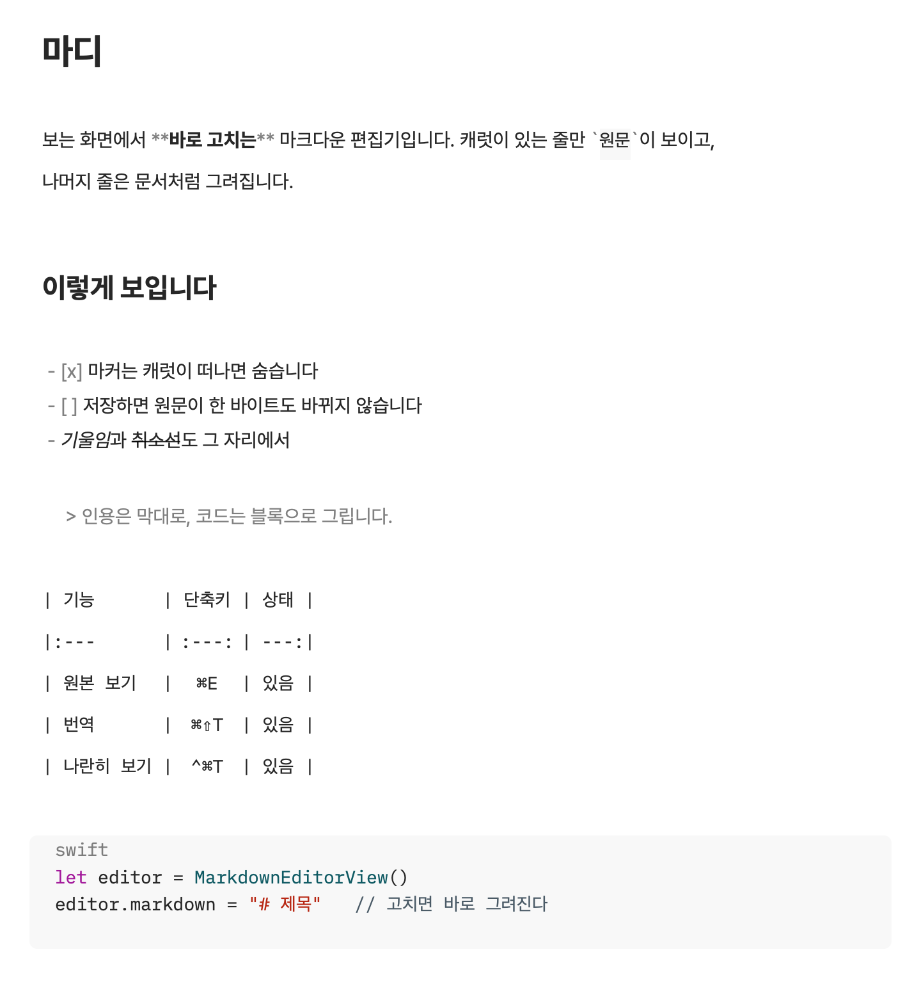

# 마디 (Madi)

[English](README.en.md)

macOS 네이티브 마크다운 에디터. **보고 있는 화면에서 바로 고칩니다** — 소스 창과 미리보기
창이 따로 있지 않고, 렌더된 문서 자체가 편집 대상입니다.



캐럿이 있는 줄(위 그림의 둘째 줄)만 `**`·`` ` `` 같은 마커가 흐리게 보이고, 나머지 줄은
문서처럼 그려집니다. 같은 문서를 `⌘E`로 보면 [원문 그대로](docs/images/source-view.png)입니다 —
저장되는 것은 그 원문이고 한 바이트도 바뀌지 않습니다. 그림은 `make screenshots`가 실제
편집기로 그린 것입니다(2026-10-30).

순우리말 **마디** — 토막·이음매, "한 마디 하다"의 그 마디입니다. 마크다운 문서는
제목·문단·표·코드블록이라는 마디의 줄이고, 이 앱은 그 마디를 다룹니다. 로마자 표기는
`Madi`이고 번들·실행 파일 이름이 그것입니다 — 두 개의 이름이 아니라 한 이름을 두 글자로
쓴 것입니다.

```sh
make build    # xcodegen → xcodebuild
make test     # 테스트 (앱을 띄우지 않음)
make run      # 빌드 후 실행
```

AppKit · Swift 6 · **Swift 의존성 없음**. 패키지 매니저도, 두 번째 버퍼도 쓰지 않고, 편집은
웹뷰가 아니라 텍스트 시스템 하나에서 합니다. 앱에 든 남의 것은 둘입니다:
글꼴 둘(본문 Pretendard, 코드 IBM Plex Mono — 둘 다 SIL OFL 1.1), 그리고 Mermaid·KaTeX를
그리는 숨은 웹뷰의 스크립트(Mermaid 12.2.0, KaTeX 0.19.1 — 둘 다 MIT,
[목록과 라이선스](Sources/Madi/Resources/Diagrams/README.md)).
빌드·테스트·기여 방법은 [빌드와 기여](docs/building.md)에 있습니다.

> **상태: 0.1.0, 아직 배포하지 않았습니다.** 서명이 ad-hoc(`CODE_SIGN_IDENTITY=-`)이라
> 직접 빌드한 Mac에서만 돕니다. 다른 Mac에서 열려면 Developer ID 서명과 공증이 필요합니다.

## 왜 하나 더 만들었나

마크다운 에디터 대부분은 둘 중 하나입니다. 원문을 그대로 보여 주거나(소스 편집), 웹뷰
안에서 렌더된 문서를 편집하거나(WYSIWYG). 마디는 **텍스트 시스템 하나로** 두 번째 느낌을
냅니다.

`NSTextStorage`에는 마크다운 원문만 들어 있고, 그 위에 두 겹을 올립니다.

1. **스타일링** — 제목은 큰 글씨, `**굵게**`는 실제 굵게, 코드는 모노스페이스에 배경,
   링크는 파란 밑줄.
2. **마커 숨김** — `#`, `**`, 백틱, 링크의 `(URL)`, 코드 펜스는 **캐럿이 그 줄에 없을 때
   폭 0이 됩니다.** 글자는 문서에 그대로 있고 화면에서만 사라집니다. 캐럿을 그 줄로
   옮기면 다시 나타나 구조를 고칠 수 있습니다.

그래서 저장되는 것은 언제나 사용자가 쓴 마크다운 그대로입니다. 문서 모델을 거쳐 다시
직렬화하지 않으므로 **열고 저장만 해도 파일이 달라지는 일이 없습니다.**

## 기능

전체 목록과 단축키는 [기능 안내](docs/features.md)에 있습니다. 요약하면:

| | |
|---|---|
| 편집 | 라이브 프리뷰 ↔ 마크다운 원본 보기 토글(`⌘E`), 11개 언어 구문 강조, 표 열 맞추기, 인라인 이미지, Mermaid 다이어그램·KaTeX 수식 블록, 각주 |
| 쓰기 | Enter로 목록·인용·체크박스 이어 쓰기, Tab·⇧Tab 들여쓰기, 체크박스 누르기, 줄 옮기기·복제·지우기, 그림 끌어놓기·붙여넣기, 글자 크기(`⌘=` `⌘-` `⌘0`) |
| 글꼴 | 본문 · 제목 · 코드 글꼴을 따로 고르기(보기 ▸ 글꼴…), 맨 위에 무료 한국어 추천 글꼴(없으면 `받기…`로 배포 페이지), 고르는 대로 바뀌는 미리보기 |
| 찾기 | 문서 내 검색(`⌘F`), 일치 개수와 이동(`⌘G`), 빠른 열기(`⌥⌘O`), 명령 팔레트(`⇧⌘P`) |
| 둘러보기 | 목차 · 최근 문서 · 파일 브라우저 사이드바(각각 토글) |
| 문서 | YAML front matter 메타데이터 카드, `NSDocument` 기반 열기·저장·자동 저장·버전 복원 |
| 내보내기 | PDF, 이미지를 `data:`로 묻은 단일 마크다운, 프린트 |
| 도구 | Apple 번역(한국어와 20개가 넘는 언어 사이, 마크업 보존, 원문·번역 나란히 보기), 기록 패널(`⌘⇧L`), 설정(`⌘,`) |
| 실험 | 블록 편집기(`⌥⌘B`) — 문서를 블록 배열로 편집하는 두 번째 창. 표를 격자로 만드는 설계의 1단계이고, 기본 편집기는 그대로입니다 |

## 요구 사항

- macOS 14 이상 (`deploymentTarget`)
- 빌드: Xcode 26 이상, [xcodegen](https://github.com/yonaskolb/XcodeGen) (`brew install xcodegen`)
- **Apple 번역은 macOS 26 이상**에서만 켜집니다(`Translation` 프레임워크). 그 아래에서는
  메뉴 항목이 비활성이고 나머지 기능은 모두 동작합니다. 번역에는 시스템에 설치된 언어
  팩이 필요하며, 없으면 받는 방법을 안내합니다.

## 지금 안 되는 것

정직하게 적습니다. 자세한 배경과 계획은 [TODO.md](TODO.md)에 있습니다.

- **표가 격자로 안 그려집니다.** 열을 맞춘 텍스트로 남습니다. 구현을 덜 한 것이 아니라
  텍스트 시스템의 모델 때문이고, 무엇으로 바꿔야 하는지는
  [블록 편집기 설계](docs/block-editor-design.md)에 적어 두었습니다.
- **AI 교정은 아직 없습니다.** 설정 ▸ AI 교정에서 Anthropic·OpenAI·Gemini·Groq·Bedrock의 API
  키를 키체인에 두고 확인할 수는 있지만, 문서를 바깥 서비스로 보낼지 정하지 않아 교정은 하지
  않습니다. 키 확인은 모델 목록만 묻습니다.
- **다이어그램과 수식은 블록만 그립니다.** ```` ```mermaid ````, ```` ```math ````, `$$` 블록은
  그림이 되지만 글 안의 `$…$`는 원문으로 남습니다. 그림은 보기 전용이고, 고치려면 캐럿을
  블록 안에 두어 원문을 고칩니다. 블록 편집기(실험)에서는 그리지 않습니다.
- **UI는 한국어와 영어 둘입니다.** 시스템 언어를 따르고, 설정 ▸ 일반 ▸ 화면 언어에서 고를 수
  있습니다(다음 실행부터). 문서(`docs/`)는 한국어뿐입니다.
- **글 사이에 끼인 이미지는 원문으로 남습니다.** 자기 줄을 차지하는 이미지만 보입니다.
- **원격 이미지는 기본으로 받아오지 않습니다.** 문서를 열었을 뿐인데 바깥으로 요청이
  나가면 안 되고, 문서에 적힌 주소가 추적용일 수도 있습니다. 설정 ▸ 일반에서 켤 수
  있고, 켜도 `https`만 받습니다.
- **메타데이터 카드는 읽기 전용입니다.** YAML을 다시 직렬화하면 파서가 모르는 구문(앵커,
  중첩 매핑, 주석)이 조용히 다시 쓰이기 때문입니다. 원문 블록을 바이트 그대로 보존합니다.
- **아주 큰 문서는 한 글자에 10ms대가 듭니다.** 22만 자(약 6천 줄) 문서에서 사람 속도로 칠 때
  한 글자에 13ms 안팎입니다(문서 어디서든, 앱에 든 글꼴). 본문 글꼴을 시스템 글꼴로 바꾸면 한글마다
  대체 글꼴을 찾아 22ms 안팎이 됩니다. 남은 몫은 고친 줄을 다시 칠하고 TextKit이 그 줄의 글리프를
  다시 만드는 데 있습니다.

## 구조

```
project.yml           xcodegen 명세 (.xcodeproj는 생성물)
Sources/Madi/
  Core/               순수 로직 — Foundation만, AppKit 없음
  Editor/             라이브 프리뷰 편집기
  Panels/             사이드바 · 카드 · 시트
  Services/           Apple 번역, 압축 해제
  App/                NSDocument · 윈도우 · 메뉴
Tests/MadiTests/      테스트 (앱을 띄우지 않음)
docs/                 설계 문서
web-prototype/        초기 웹 프로토타입 (참고용)
```

`Core`가 AppKit을 쓰지 않는 것은 지켜지는 불변식입니다 — `make core-only`가 그 파일들만
따로 타입 체크해 깨지면 실패합니다. 자세한 것은 [구조 안내](docs/architecture.md).

## 다른 앱과의 관계

마디의 화면 구성과 단축키는 상용 마크다운 에디터 **Mark.app**을 보고 맞춘 것입니다 —
도구 막대의 버튼 순서, `⌘⇧F`/`⌘⇧R`/`⌘⇧O`/`⌘E` 같은 단축키, 검색이 "모든 일치를 칠하는"
방식이 그렇습니다. 그 앱을 쓰다가 "네이티브였으면 좋겠다"고 생각한 것이 이 저장소의
출발점입니다.

**코드를 가져오지 않았습니다.** 마디는 AppKit으로 처음부터 쓴 것이고, Mark.app은 Rust +
웹뷰 앱이라 공유할 코드가 애초에 없습니다. 밖에서 보이는 동작을 관찰해 같은 규칙을 구현했고,
의도적으로 다르게 한 것은 [기능 안내](docs/features.md)에 그 이유와 함께 적어 두었습니다.

## 라이선스

[MIT](LICENSE).
