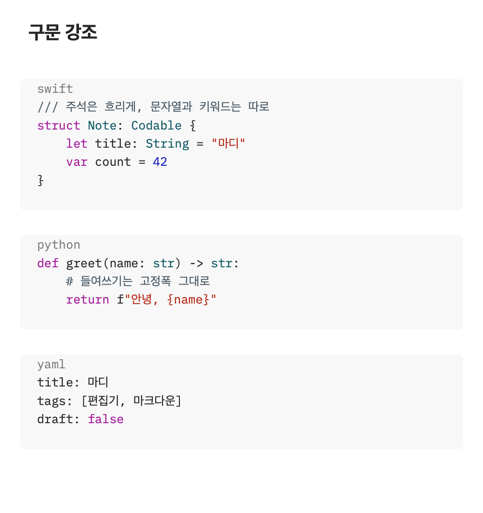
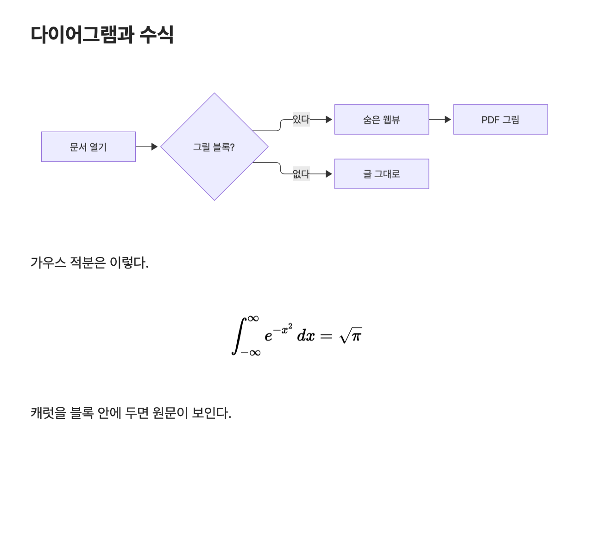

# 기능 안내

마디가 지금 할 수 있는 일 전부입니다. 각 항목은 "무엇을 하는가"와, 그렇게 만든 이유 중
설명이 필요한 것만 적었습니다. 아직 못 하는 일은 [README](../README.md#지금-안-되는-것)와
[TODO](../TODO.md)에 있습니다.

## 단축키 전체

메뉴 바는 **명령 표 하나**(`Sources/Madi/App/AppMenu.swift`)에서 만들어지고, 명령 팔레트(`⇧⌘P`)와
도구 막대의 버거 메뉴는 그 메뉴 바를 읽으므로 세 곳이 어긋날 수 없습니다. 아래 표가 그 명령 표입니다.

| 단축키 | 동작 | 메뉴 |
|---|---|---|
| `⌘N` | 새로 만들기 | 파일 |
| `⌘O` | 문서 열기… | 파일 |
| `⌥⌘O` | 빠른 열기… | 파일 |
| `⌘⇧F` | 파일 브라우저 | 파일 |
| `⌘⇧R` | 최근 문서 | 파일 |
| `⌘S` | 저장 | 파일 |
| `⌘⇧S` | 다른 이름으로 저장… | 파일 |
| — | 되돌리기 | 파일 |
| — | 이미지 포함 내보내기… | 파일 |
| — | PDF 내보내기… | 파일 |
| `⌘P` | 프린트하기… | 파일 |
| `⌘W` | 닫기 | 파일 |
| `⌘Z` / `⌘⇧Z` | 실행 취소 / 복귀 | 편집 |
| `⌘X` `⌘C` `⌘V` `⌘A` | 잘라내기 · 복사 · 붙여넣기 · 모두 선택 | 편집 |
| `⌘F` | 검색 | 편집 |
| `⌘G` / `⌘⇧G` | 다음 / 이전 찾기 | 편집 |
| `⌥⌘[` / `⌥⌘]` | 줄 위로 / 아래로 옮기기 | 편집 |
| `⌘D` | 줄 복제 | 편집 |
| `⇧⌘K` | 줄 지우기 | 편집 |
| `⌥⌘0` / `⌘1`~`⌘6` | 본문 / 제목 1~6 | 서식 ▸ 제목 |
| `⌘B` / `⌘I` | 굵게 / 기울임 | 서식 |
| `⇧⌘X` / `⇧⌘C` | 취소선 / 인라인 코드 | 서식 |
| `⌘K` | 링크 | 서식 |
| `⇧⌘8` / `⇧⌘7` / `⇧⌘9` | 글머리 / 번호 / 할 일 목록 | 서식 |
| `⌥⌘Q` | 인용 | 서식 |
| `⌥⌘C` | 코드 블록 | 서식 |
| — | 표 · 구분선 | 서식 |
| `⇧⌘P` | 명령 팔레트… | 보기 |
| `⌘⇧O` | 목차 | 보기 |
| `⌘E` | 마크다운 원본 보기 | 보기 |
| `⌥⌘B` | 블록 편집기 (실험) | 보기 |
| `⌘=` (`⌘+`) / `⌘-` / `⌘0` | 글자 크게 / 작게 / 기본 크기 | 보기 |
| — | 전체 화면 시작 | 보기 |
| `⌘⇧T` | Apple 번역 | 도구 |
| `⌥⌘⇧T` | 번역 언어 선택… | 도구 |
| `⌃⌘T` | 원문·번역 나란히 보기 | 도구 |
| `⌘⇧L` | 기록 보기 | 도구 |
| `⌘,` | 설정 | 마디 |

`⌘N`이 새 **문서**인 것은 의도된 차이입니다. `NSDocument` 앱에서 `⌘N`은 시스템 전체의
관례가 새 문서이고, 새 문서는 어차피 자기 창에서 열리므로 눈에 보이는 결과는 같습니다.

## 도구 막대

**분할 단추 두 덩이**와 가운데의 **서식 단추**, 검색 칸, 맨 오른쪽의 **버거 메뉴**입니다. 다른 macOS 앱과 같은
시스템 단추라, 모양 · 크기 · 눌린 표시(강조색)가 같습니다.

| 덩이 | 칸 | 하는 일 |
|---|---|---|
| 사이드바 (제목 옆) | **목차** · **폴더** · **최근** | 사이드바의 그 탭을 열고, 눌린 칸을 다시 누르면 닫기 (`⌘⇧O` · `⌘⇧F` · `⌘⇧R`) |
| 서식 (가운데) | **제목 ▾**(`#`) · **굵게** · **기울임** · **취소선** · **인라인 코드** · **링크** · **블록 ▾**(목록) | 서식 메뉴와 같은 명령 — 아래 '서식'. 누르면 한 번 하고 눌린 채 남지 않습니다 |
| 찾기 | 일치 개수 · **검색** | 문서 내 검색 (`⌘F`) |
| 보기 (오른쪽) | **원본 보기**(`</>`) · **나란히 번역**(번역 기호) | 마크다운 원본 (`⌘E`) · 원문과 번역을 좌우로 (`⌃⌘T`) |
| 메뉴 (맨 오른쪽, `≡`) | 주요 명령, **모든 메뉴**(파일 · 편집 · 보기 · 도구 · 윈도우 ▸), **설정…** | 자주 쓰는 명령을 바로, 나머지는 메뉴 바와 같은 메뉴로, 그리고 설정 (`⌘,`) |

버거 메뉴는 위에서부터 세 칸입니다.

1. **주요 명령** — 새로 만들기 · 문서 열기… · 빠른 열기… | 저장 · 다른 이름으로 저장… | PDF 내보내기… · 이미지
   포함 내보내기… · 프린트하기… | 테마 ▸ · 글꼴… | Apple 번역 · 번역 언어 선택… | 명령 팔레트…. 도구 막대에
   단추가 있는 것(목차 · 폴더 · 최근, 원본 보기, 나란히 번역, 검색)은 넣지 않았습니다.
2. **모든 메뉴** — 메뉴 바의 파일 · 편집 · 보기 · 도구 · 윈도우를 같은 이름 · 차례의 하위 메뉴로.
3. **설정…** — 앱 메뉴(마디)에서는 이것만 가져왔습니다. 가리기 · 종료는 도구 막대에서 고를 까닭이 없어서입니다.

버거 메뉴는 **열 때마다 메뉴 바에서 옮겨 싣습니다.** 주요 명령도 메뉴 바의 같은 항목을 복사한 것이라, 이름 ·
단축키 표시 · 체크(원본 보기, 테마) · 켜지고 꺼지는 것까지 메뉴 바와 같습니다. 메뉴 바에 무엇이 더해지면
모든 메뉴에도 따라옵니다. 단축키는 메뉴 바만 받습니다(같은 키가 두 메뉴에 걸리지 않게).

사이드바 덩이의 칸은 사이드바 탭과 **같은 이름, 같은 차례**이고, 눌린 칸이 곧 열린 탭입니다(사이드바가
닫혀 있으면 눌린 칸이 없습니다). 보기 덩이는 칸마다 켜고 끕니다. 마우스를 올리면 무엇을 하는지와 단축키가
나옵니다.

서식 단추는 **캐럿이 있는 편집기**를 고칩니다(나란히 보기의 번역본 칸에 캐럿이 있으면 그쪽). 캐럿이 검색 칸 같은
편집기 밖에 있으면 원문 편집기로 돌아가서 합니다. 블록 ▾에는 글머리 · 번호 · 할 일 목록, 인용, 코드 블록, 표,
구분선이 있습니다.

도구 막대의 아이콘은 모두 **10pt**로 그립니다 — 시스템 기본보다 작아, 서식 칸을 더한 막대가 덜 빽빽합니다.
칸의 크기와 테두리는 시스템 그대로입니다. 검색의 돋보기만은 시스템이 그려 조금 큽니다. 글을 고르면 뜨는 서식
막대의 아이콘도 같은 10pt입니다.

새 창은 **폭 960pt**로 열립니다 — 도구 막대의 칸이 모두 보이는 폭입니다. 창을 좁히면 제목 ▾ · 블록 ▾ · 일치
개수가 먼저 펼침(») 메뉴로 들어가고, 더 좁히면 글자 꾸밈 묶음이 갑니다. 사이드바 · 검색 · 보기 · 버거는 끝까지
남습니다. 검색 칸은 자리가 모자라면 돋보기 단추로 줄어듭니다(누르면 펼쳐집니다).

처음에는 아이콘만 보입니다. 도구 막대를 **우클릭**해 `아이콘과 텍스트`를 고르면 칸마다 이름이 나오고
(macOS 15 이상), 고른 것은 다음 창에도 이어집니다.

2026-11-07에 고친 것: 전에는 단추 일곱이 따로 놓여 칸마다 다른 둥근 테두리가 생겼고(`열기`만 테두리가 없었다),
사이드바 셋이 두 곳에 갈렸으며, 폴더 아이콘이 `문서 열기`였습니다. `열기` 단추는 뺐습니다 — `⌘O`, 파일 메뉴,
빠른 열기(`⌥⌘O`)가 있습니다. 버거 메뉴는 같은 날 한 번 뺐다가 다시 넣었습니다. 뺀 판은 명령 표에서 열일곱만
따로 골라 만들어 편집 · 테마 · 글꼴이 없었고 이름도 조금 달랐습니다. 다시 넣은 판은 메뉴 바를 그대로 보입니다.

## 편집

### 라이브 프리뷰

제목(`#` 꼴과 `===`/`---` 밑줄 꼴 둘 다)·굵게·기울임·취소선·인라인 코드·링크·참조 링크·
인용·GitHub 알림·목록·체크박스·각주·수평선·코드블록을 그립니다.
마커(`#`, `**`, 백틱, `(URL)`, `][참조]`, 코드 펜스)는 **캐럿이 그 줄에 없을 때 폭 0**이 됩니다.

참조 링크는 `[글][참조]` · `[참조][]` · `[참조]` 세 꼴과 참조 그림 `![그림][라벨]`을
받습니다. 정의 줄(`[참조]: url "제목"`)은 라벨만 접히고 **주소는 남아 ⌘클릭으로 열립니다** —
렌더러는 그 줄을 통째로 삼키지만, 편집기에서 줄이 통째로 사라지면 자기가 친 글자가
어디로 갔는지 알 수 없습니다. 정의가 **없는** 참조는 링크가 아니라 평범한 글자입니다
(CommonMark). 그 규칙이 없으면 `[보류]` 같은 대괄호 글이 전부 밑줄 친 링크가 됩니다.

**링크는 `⌘클릭`으로 엽니다.** 그냥 클릭은 링크 글을 고치러 들어가는 것이라 캐럿을 놓습니다.
웹 주소는 기본 브라우저로, 상대 경로의 문서는 마디로 엽니다. (첫 판부터 이것이 문서에만 있고
동작하지 않았습니다 — 스타일러가 주소를 글자에 달기만 하고 읽는 곳이 없었습니다.) 링크를 우클릭해
`링크 열기`로 열 수도 있습니다(아래 '우클릭 메뉴').

### 우클릭 메뉴

편집기의 우클릭 메뉴는 꼭 필요한 것과 마디의 것만 둡니다.

| 어디서 | 항목 |
|---|---|
| 링크 위(글의 링크, 격자 표 칸의 링크) | **링크 열기** · **링크 주소 복사** |
| 늘 | **잘라내기** · **복사** · **붙여넣기** |
| 글을 골랐을 때(원문 편집기) | **선택한 글 번역** — `⌘⇧T`와 같이 그 자리에서 바꿉니다 |

macOS가 기본으로 넣던 항목(찾아보기 · 시스템 번역 · Google 검색 · 공유 · 서체 · 글쓰기 도구 · 맞춤법 · 대체 ·
말하기 · 자동 완성 · 서비스 등 열일곱)은 뺐습니다. 서체는 서식 없는 마크다운에 맞지 않고, 맞춤법은 꺼 두었습니다.
글쓰기 도구 · 받아쓰기 · 이모지는 메뉴 바의 편집 메뉴에 그대로 있습니다. 원본 보기에서는 링크 항목이 없습니다
(⌘클릭과 같습니다). 나란히 보기의 번역본 칸에는 `선택한 글 번역`이 없습니다 — 번역은 원문의 선택을 읽기
때문입니다.

**인용**은 `>`를 다른 마커처럼 캐럿이 없는 줄에서 숨기고, 이어진 인용 줄 왼쪽에 **막대 하나**를
그립니다. 빈 인용 줄(`>`)은 덩이를 끊지 않고 문단을 가릅니다. 덩이 안의 줄 사이에는 문단 간격을
두지 않아 여러 줄 인용이 한 덩이로 읽힙니다. `>>`처럼 겹치면 겹마다 막대가 하나 더 있고 한 칸 더
들어갑니다. 글은 본문보다 조금 옅은 불투명 회색입니다(대비 4.5 : 1 이상 — 전에 쓰던 반투명 회색은
몇 줄을 읽기에 흐렸습니다).

**GitHub 알림**(`> [!NOTE]` · `[!TIP]` · `[!IMPORTANT]` · `[!WARNING]` · `[!CAUTION]`)은 GitHub처럼 그립니다 —
막대와 머리가 그 종류의 색이고, 표식 줄 자리에 아이콘과 제목(`Note` · `Tip` · `Important` · `Warning` ·
`Caution`)이 나옵니다. 아이콘은 GitHub의 것과 가장 가까운 SF Symbols입니다(원 안의 i, 전구, 말풍선, 세모,
팔각형). 제목은 GitHub처럼 화면 언어와 상관없이 영어입니다. 표식 글자는 문서에 그대로 있고 투명하게 칠한 뒤
그 자리에 그립니다 — 캐럿이 표식 줄에 오면 `[!NOTE]` 원문이 보입니다. 덩이의 **첫 줄**이 표식 하나뿐일
때만 알림입니다(GitHub와 같은 규칙). 프린트 · PDF에도 그대로 찍힙니다. 블록 편집기(⌥⌘B)는 전처럼 표식을
색 글자로 둡니다.

캐럿이 있는 줄에만 마커를 보이는 것이 설계의 핵심입니다. 문서 모델 WYSIWYG은 마커를 아예
없애고 원문을 보려면 별도의 원본 보기로 전환해야 하는데, 이쪽은 구조를 고칠 때만 그 줄의
마커가 돌아오므로 전환이 없습니다.

**한국어에서 기울임**: CJK 글자는 italic 글꼴로 바꿔도 모양이 **한 픽셀도** 달라지지
않습니다(시스템 한글 글꼴에 기울어진 외곽선이 없습니다). 그래서 CJK 글자에만 강제 기울임
(`obliqueness`)을 더합니다 — 모두에 주면 영문이 두 번 기웁니다. 그리고 `*기울임*은`처럼
조사가 바로 붙어도 인식됩니다(CommonMark대로 `*`는 낱말 안 강조를 허용하고 `_`는 막습니다).

### 목록 쓰기 — Enter · Tab

마크다운 편집기 대부분(Typora, Obsidian, Bear)과 같은 규칙입니다.

| 키 | 자리 | 하는 일 |
|---|---|---|
| Enter | 내용이 있는 항목 | 캐럿 자리에서 나누고 새 줄에 같은 표지를 붙입니다. 번호는 하나 올리고(`9)` → `10)`), 체크박스는 빈 칸 `[ ]`으로 |
| Enter | 빈 항목 | 목록을 끝냅니다(표지를 떼고 빈 줄). 하위 항목이면 한 단계 내어 씁니다. 인용 안의 목록이면 인용은 남깁니다 |
| Enter | 인용 `> ` | 다음 줄도 같은 막대로. 빈 인용 줄에서는 인용을 끝냅니다 |
| Tab / ⇧Tab | 목록 항목(어디서든) | 들여쓰기 / 내어쓰기. 고른 줄이 여럿이면 목록 항목마다 |

들여쓰는 폭은 **바로 위 항목의 표지 폭**입니다 — `- ` 아래는 두 칸, `1. ` 아래는 세 칸. 그래야
CommonMark에서 그 항목의 하위가 됩니다. 탭으로 들여쓴 문서는 탭을 씁니다. 내어 쓰면 위 항목과
같은 깊이로 돌아갑니다.

손대지 않는 자리: 코드 블록 안(펜스 안의 `- `는 목록이 아닙니다), 표지 앞이나 안의 Enter
(항목을 통째로 아래로 미는 동작), 목록이 아닌 줄의 Tab(탭 문자), 한글을 조합하는 중의 Enter.
각 동작은 `⌘Z` 한 번으로 돌아갑니다.

### 체크박스

보기 모드에서는 `[ ]`·`[x]`가 **상자로 보입니다** — 빈 칸은 테두리, 한 일은 강조색으로 채운 상자에
흰 체크 표시. 캐럿이 그 줄에 오면 다른 마커처럼 원문 `[ ]`이 돌아옵니다. 글자를 지우지 않고 투명하게
칠한 뒤 그 자리에 그리므로 폭이 그대로이고(캐럿이 들어와도 줄이 밀리지 않습니다) 프린트·PDF에도
상자로 나옵니다. 마크다운 원본 보기(`⌘E`)와 블록 편집기에서는 원문 그대로입니다.

상자를 **누르면 뒤집힙니다.** 캐럿은 옮겨 가지 않고, `⌘Z` 한 번으로 돌아갑니다(편집 ▸
실행 취소 '할 일 표시'). 보조 키를 누른 클릭(⇧클릭은 선택 늘리기)은 평소대로입니다.

### 각주

GFM 각주 `[^1]`과 정의 줄 `[^1]: 글`. 참조는 괄호가 접히고 라벨이 작은 위첨자로, 정의 줄은
`[^`와 `]:`가 접히고 라벨이 위첨자 머리로 보입니다. **`⌘클릭`으로 오갑니다** — 참조에서 정의의
글 앞으로, 정의의 라벨에서 첫 참조 뒤로.

정의가 없는 참조는 각주가 아니라 평범한 대괄호 글입니다(참조 링크와 같은 약속). 정의 줄은 링크
정의 꼴(`[^1]: https://…`)과 겹쳐도 각주로 읽습니다(GFM). Apple 번역은 참조를 그대로 두고, 정의는
머리(`[^1]: `)를 남긴 채 글만 옮깁니다.

한계: 여러 문단짜리 각주(들여쓴 이어지는 문단)는 첫 줄만 정의로 읽고 나머지는 보통 문단입니다.
번호를 다시 매기지 않습니다 — `[^note]`는 `note`라는 위첨자로 보입니다.

### 줄 편집

| 단축키 | 동작 |
|---|---|
| `⌥⌘[` / `⌥⌘]` | 줄 위로 / 아래로 옮기기(Xcode의 키) |
| `⌘D` | 줄 복제 — 아래에 한 벌 더 놓고 선택을 그쪽으로(이어서 누르면 쌓입니다) |
| `⇧⌘K` | 줄 지우기(VS Code의 키) |

선택이 걸친 **줄 전체**가 단위입니다. 다음 줄의 맨 앞에서 끝나는 선택은 그 줄을 포함하지
않습니다(줄을 끌어 고르면 선택이 거기서 끝납니다). 마지막 줄을 옮기거나 지워도 줄이 붙거나 빈
줄이 남지 않고, `\r\n` 줄바꿈은 그대로 둡니다. 검색 칸에 캐럿이 있으면 메뉴가 회색입니다.

### 서식 — 서식 메뉴 · 도구 막대 · 서식 막대

메뉴 바의 **서식**(편집 다음)이 마크다운 표식을 넣고 뺍니다. 문서는 마크다운 글 그대로이고, 메뉴는 그 글에
표식을 적어 줄 뿐입니다 — 손으로 `**`를 치는 것과 같은 결과입니다. 같은 명령이 세 곳에 더 있습니다.

- **도구 막대 가운데의 아이콘** — 제목 ▾ · 굵게 · 기울임 · 취소선 · 인라인 코드 · 링크 · 블록 ▾(위 '도구 막대').
- **서식 막대** — 글을 고르면 고르기가 멈춘 뒤 그 글 바로 위에 작은 막대가 뜹니다: 제목 ▾ · 굵게 · 기울임 · 취소선 ·
  인라인 코드 · 링크. 맨 윗줄이라 위에 자리가 없으면 아래에 뜹니다. 눌러도 선택이 그대로 남아 굵게를 누른 뒤
  바로 기울임을 누를 수 있습니다. 고른 것이 없어지거나, 캐럿이 편집기 밖으로 가거나, 한글을 조합하는 동안에는
  뜨지 않습니다. 프린트 · PDF에는 찍히지 않습니다.
- 명령 팔레트(`⇧⌘P`)와 버거 메뉴의 `모든 메뉴 ▸ 서식`.

| 항목 | 단축키 | 하는 일 |
|---|---|---|
| 제목 ▸ 본문 · 제목 1~6 | `⌥⌘0` · `⌘1`~`⌘6` | 줄 앞에 `#`~`######`. 같은 단계를 다시 누르면 본문 |
| 굵게 · 기울임 · 취소선 · 인라인 코드 | `⌘B` · `⌘I` · `⇧⌘X` · `⇧⌘C` | 고른 글을 `**` · `*` · `~~` · `` ` ``로 감싸고, 다시 누르면 풉니다 |
| 링크 | `⌘K` | `[고른 글]()` — 캐럿이 주소 칸으로. 주소를 골랐으면 `[](주소)`에 캐럿이 글 칸으로 |
| 글머리 · 번호 · 할 일 목록 | `⇧⌘8` · `⇧⌘7` · `⇧⌘9` | 줄마다 `- ` · `1. ` · `- [ ] `. 다른 목록이면 바꾸고, 같은 목록이면 풉니다 |
| 인용 | `⌥⌘Q` | 줄마다 `> `. 사이의 빈 줄은 `>`가 되어 한 덩이로 남습니다 |
| 코드 블록 | `⌥⌘C` | 고른 줄을 ```` ``` ````로 감싸고 캐럿을 언어 이름 자리에 둡니다. 빈 줄이면 빈 블록 |
| 표 · 구분선 | — | 열 둘짜리 표(첫 칸 글을 골라 둡니다) · `---` |

몇 가지 규칙:

- 고른 것이 없으면 표식 한 쌍을 넣고 캐럿을 가운데 둡니다(`**|**`). 빈 쌍 가운데서 다시 누르면 지웁니다.
- 고른 글 앞뒤의 공백과 줄 앞의 블록 표식(`#` · `-` · `1.` · `>`)은 감싸지 않습니다 — `** 글 **`나 `**# 제목**`은
  마크다운이 꾸밈으로 읽지 않습니다.
- 여러 줄을 고르면 줄마다 합니다. 모든 줄이 이미 꾸며져 있으면 모두 풀고, 아니면 안 꾸민 줄만 감쌉니다.
- `*` 하나는 기울임, 둘은 굵게, 셋은 둘 다입니다. 굵은 글을 기울이면 `***`, 거기서 굵게를 다시 누르면 `*`만 남습니다.
- 빈 줄에서 제목 · 목록 · 인용을 누르면 그 줄을 그것으로 시작합니다(이어서 쓰면 됩니다).
- 번호 목록은 들여쓰기마다 1부터 셉니다. 할 일 목록으로 바꿀 때 이미 체크한 항목은 그대로 둡니다.
- 표와 구분선은 위아래의 글과 빈 줄 하나로 띄웁니다 — 글 바로 아래의 `---`는 구분선이 아니라 제목 2입니다.
- 명령마다 실행 취소 한 번에 되돌아갑니다(`굵게 실행 취소`처럼 이름이 붙습니다).

단축키는 널리 쓰는 것을 따랐습니다 — `⌘B` · `⌘I` · `⌘K`는 거의 모든 편집기, 목록과 취소선은 Google 문서,
인라인 코드는 Slack, 인용 · 코드 블록은 Typora. 인라인 코드에 흔히 쓰는 `⌘E`는 마디에서 마크다운 원본 보기이고,
본문의 `⌘0`은 글자 기본 크기라 본문은 `⌥⌘0`입니다. Steno 도움말에는 서식 메뉴가 적혀 있지 않아 따라 할 표가
없었습니다.

### 그림 넣기 — 끌어놓기 · 붙여넣기

그림 파일을 끌어놓거나 붙여 넣으면 **문서 옆의 `<문서 이름>.assets` 폴더**에 복사하고
`` 줄을 넣습니다(Typora와 같은 자리). 문서와 그림이 한 곳에 모여
폴더째 옮기거나 `이미지 포함 내보내기`로 묶기 쉽고, 문서마다 폴더가 따로라 이름이 부딪히지
않습니다.

- 문서 폴더 **안에 이미 있는** 그림은 복사하지 않고 그 자리를 가리킵니다.
- 같은 이름이 있으면: 내용이 같으면 그 파일을 쓰고, 다르면 `이름-2.png`.
- 화면 캡처처럼 파일이 아닌 그림은 `image-날짜-시각.png`(PNG)로 적습니다.
- 그림은 자기 줄이어야 그려지므로 앞뒤가 글이면 줄을 바꿔 줍니다.
- 경로는 공백·괄호·`%`·꺾쇠만 퍼센트 인코딩합니다(한글은 그대로).
- **저장하지 않은 문서에는 넣지 않습니다** — 둘 폴더가 없고, 절대 경로로 적으면 문서를 옮기는
  순간 깨집니다. 먼저 저장하라고 알립니다.

대지에서 그림을 쓰지 않는 경우가 둘입니다. 글이 그림보다 앞에 있을 때(웹 페이지를 복사하면
글과 그림이 함께 실리는데, 글 편집기에 붙이는 사람은 글을 원합니다), 파일이 함께 있을 때(Finder
에서 그림이 아닌 파일을 복사하면 파일 아이콘이 그림으로 따라옵니다).

### 마크다운 원본 보기 `⌘E`

![README 맨 위 그림과 같은 문서를 원본 보기로 본 화면. 고정폭 글자로 # 제목 표시, ** 굵게 표시, 목록의 - [x], 인용의 >, 표의 | 와 구분 행, 펜스 ```swift 가 모두 그대로 보이고 표시 기호는 흐리다](images/source-view.png)

같은 문서를 모노스페이스로, 마커를 전부 보이게 다시 그립니다. 다른 버퍼가 아니라 같은
저장소의 다른 표시 방식입니다.

### 구문 강조



코드블록의 정보 문자열(```` ```swift ````)을 읽어 칠합니다. 11개 언어:

`swift` · `javascript`/`typescript`(`js` `ts` `jsx` `tsx` …) · `python` · `shell`(`sh`
`bash` `zsh` `console`) · `json` · `rust` · `go` · `yaml` · `css` · `html` · `sql`

**모르는 언어는 칠하지 않습니다.** 규칙을 모르는 언어에 C 비슷한 규칙을 억지로 대면 틀린
강조가 나옵니다 — `#`은 셸에서 주석이지만 C에서는 전처리기입니다. 틀린 색보다 검은 글자가
낫습니다.

정규식이 아니라 한 번 훑는 스캐너입니다. 주석과 문자열은 다른 모든 것을 이겨야 하고(주석
안의 `if`는 키워드가 아닙니다), 줄을 넘나드는 구문(`/* */`, 파이썬 독스트링, JS 템플릿
리터럴)은 줄 단위 정규식으로 맞출 수 없기 때문입니다. 닫히지 않은 따옴표는 줄 끝에서
멈춥니다 — 안 그러면 치는 중에 따옴표 하나가 블록 나머지 전부를 문자열로 만듭니다.

### 표 — 격자로 그리기와 열 맞추기

캐럿이 표 밖에 있으면 표를 **격자로** 그립니다. 막대(`|`)와 구분 행(`| --- |`)은 보이지 않고,
머리 행은 굵게 바탕을 깔며, 칸은 본문 글꼴로 씁니다. 긴 칸은 표를 넓히지 않고 **칸 안에서 줄을
바꿉니다.** 열 너비는 칸의 글을 한 줄로 쓴 폭을 따르고, 다 합쳐 글 넓이를 넘으면 짧은 열은 제 폭을
갖고 긴 열들이 나머지를 나눕니다 — 이름 열은 한 줄로 남고 설명 열만 꺾입니다. 정렬(`:---` /
`:--:` / `---:`)과 칸 안의 굵게 · 기울임 · 코드 · 링크도 그립니다.

왜 원문 위에 맞추지 않고 따로 그리는가: 원문의 한 행은 한 줄이라 행이 글 넓이보다 길면 **행 자체가
다음 줄로 넘어갑니다.** 860pt 창에서 세 열 한국어 표를 열어 보니 여덟 행이 모두 그렇게 꺾여 막대가
다음 줄 첫머리로 떨어졌습니다. 칸 안에서 줄을 바꾸려면 칸이 제 폭을 가진 상자여야 하는데, 원문을
고치지 않고는 글자 속성으로 그 상자를 만들 수 없습니다. 그래서 다이어그램처럼 표 자리를 비우고
그 자리에 그립니다. **문서는 한 바이트도 바뀌지 않습니다.**

격자 칸의 링크도 **`⌘클릭`으로 엽니다**(본문의 링크와 같습니다). 격자는 그림이라 텍스트 뷰가 그
안의 글자를 모르므로, 누른 칸의 글을 그릴 때와 같은 폭으로 다시 놓아 보고 점 아래의 글자를 찾습니다.
링크가 아닌 글자나 칸의 빈 자리를 ⌘클릭하면 아무 일도 없습니다.

캐럿이 표에 들어오면(보조 키 없는 클릭이나 화살표) 원문으로 돌아갑니다. 문서 내 검색에서 지금 찾은 곳이 표
안이어도 원문으로 펼쳐 찾은 글자가 보입니다. 원본 보기(`⌘E`)는 늘 원문이고, 프린트 · PDF는
캐럿이 없으니 모든 표가 격자입니다.

**원문의 열 맞추기**: 표를 고치는 동안 보이는 원문은 열을 맞춰 둡니다. 칸에 공백을 끼워 넣는 흔한
방법은 저장할 때 원문을 바꾸므로 쓸 수 없어, 글자 간격(`.kern`)으로 나아감만 늘립니다. 행을 더하거나
칸을 넓히면 모든 행이 함께 다시 맞춰집니다. 설정의 `표 열 맞추기`는 이 원문 맞추기를 켜고 끕니다
(격자는 늘 그립니다). 한계: 캐럿이 있는 줄은 마커가 보여 그 칸이 열 너비보다 넓어질 수 있고,
그때는 그 줄만 밀린 채 둡니다.

### 인라인 이미지

자기 줄을 차지하는 ``를 그 자리에 그립니다. 창보다 큰 그림은 폭에 맞춰 줄입니다.
수정 시각과 크기를 열쇠로 캐시하므로 파일을 고치면 다시 읽습니다.

**원격 주소는 기본으로 받아오지 않습니다** — 문서를 열었을 뿐인데 바깥으로 요청이 나가면
안 되고, 문서의 주소가 추적용일 수도 있습니다. 설정 ▸ 일반 ▸ `원격 이미지 불러오기`로
켤 수 있고, 켜도 지키는 것이 있습니다: `https`만 받고(평문은 중간에 있는 누구나 어떤
문서를 열었는지 봅니다), 리다이렉트는 세 번까지이며 `https` → `http` 강등을 거절하고,
20MB를 넘으면 버리고, 쿠키를 쓰지 않습니다. 받은 것과 실패는 기록 패널(`⌘⇧L`)에 남고,
실패한 주소는 다시 시도하지 않습니다. 끄면 받아 둔 것도 버립니다.

못 읽은 그림은 원문을 그대로 두고 기록에 경고를 남깁니다.

글 사이에 끼인 그림은 원문으로 남습니다(가로 자리 잡기가 전혀 다른 문제입니다).

### 다이어그램과 수식



이 블록들을 그림으로 그립니다.

| 쓰는 법 | 그리는 것 |
|---|---|
| ```` ```mermaid ```` 펜스 | Mermaid 다이어그램 — 순서도, 시퀀스, 클래스, 상태, ER, 간트, 원그래프, 마인드맵 등 Mermaid가 그리는 것 전부 |
| ```` ```math ```` 펜스(`katex`도 됩니다) | KaTeX 수식(글 넓이의 가운데에 놓입니다) |
| `$$`만 있는 줄로 열고 닫기, 또는 한 줄짜리 `$$ … $$` | KaTeX 수식 |

**캐럿을 블록 안에 두면 원문이 보입니다.** 그림을 누르거나 화살표로 들어가면 블록 전체가
원문으로 펼쳐지고, 나오면 다시 그림이 됩니다. 원문이 틀리면(그리지 못하면) 원문 그대로 두고
Mermaid·KaTeX의 오류 문장을 기록 패널(`⌘⇧L`)에 남깁니다. 마크다운 원본 보기(`⌘E`)에서는
그리지 않습니다. 닫히지 않은 블록(치는 중)은 그리지 않습니다 — 그 아래 글 전체가 블록으로
읽히기 때문입니다. 짝 없는 `$$`는 빈 줄에서 끝나므로 문서 끝까지를 수식으로 삼키지 않습니다.
Apple 번역(`⌘⇧T`)은 수식 블록을 건드리지 않습니다 — 펜스든 `$$`든 원문 그대로 둡니다.

**그리는 곳은 숨은 웹뷰 하나입니다.** 편집은 여전히 텍스트 시스템에서 하고, 웹뷰는 블록 하나의
원문을 받아 그림을 PDF로 돌려줄 뿐입니다 — 벡터라서 글자를 키우거나 프린트해도 흐려지지
않습니다. 그릴 블록이 없는 문서는 웹 프로세스를 띄우지 않고, 앱 전체에 웹뷰는 하나입니다.
**바깥으로 아무것도 나가지 않습니다**: 페이지의 CSP, 웹킷 콘텐츠 규칙(`http`·`https`·`ws`·`ftp`
차단), 처음 페이지 말고는 이동을 모두 거절하는 대리자가 막고, Mermaid는 `securityLevel: strict`로
돌려 라벨 안의 HTML을 걷어 냅니다.

그림은 본문 글꼴(기본 Pretendard)과 크기를 따르고, 다크 화면에서는 Mermaid의 다크 테마와 밝은
글자로 다시 그립니다. 넓은 그림은 글 넓이에 맞춰 줄입니다. 간트 차트는 폭을 800pt로 정해 둡니다.

한계: 글 안의 `$…$`(인라인 수식)는 그리지 않습니다. 그림은 보기 전용입니다(그림을 끌어 고치지
않습니다). 블록 편집기(실험)에서는 그리지 않습니다.

## 찾기

`⌘F`로 열고, 대소문자와 분음부호를 무시하는 **단순 부분문자열** 검색입니다. 정규식도 퍼지
매칭도 인덱스도 없고, 일치하는 모든 곳을 한 번에 칠합니다. `⌘G` / `⌘⇧G`로 이동하고 도구
막대에 `n / 총계`가 나옵니다.

큰 문서를 위한 가드가 둘 있습니다. 18만 자를 넘으면 디바운스를 80ms에서 180ms로 늘리고,
25만 자를 넘으면 한 글자 질의는 무시합니다(문서의 상당 부분이 칠해질 뿐 알려 주는 것이
없습니다).

찾은 곳은 호박색 바탕(지금 찾은 곳은 더 진한 주황)에 **짙은 글자**로 칠합니다. 테마와 상관없이 같은 색이고
불투명합니다. 다크 테마의 흰 글자를 그대로 두면 호박색 위에서 대비가 1.4 : 1이라, 찾은 곳의 글자만 짙은 색으로
바꿉니다(12.9 : 1, 지금 찾은 곳 위에서 8.8 : 1). 찾기를 끝내면 원래 색으로 돌아옵니다.

인덱스 계산은 `NSString.range(of:options:)`로 합니다. 양쪽을 소문자화해 비교하는 흔한
방법은 **문자열 길이가 바뀔 수 있어**(터키어 `İ` → 두 코드 유닛) 그 뒤의 모든 인덱스가
밀리고 강조가 엉뚱한 글자에 붙습니다.

## 빠른 열기 `⌥⌘O` · 명령 팔레트 `⇧⌘P`

창 위에 고르개가 뜹니다. 치면 걸러지고, ↑↓로 고르고, ↩로 열거나 실행하고, ⎋로 닫습니다.
걸러내기는 **글자가 순서대로 다 있으면** 맞는 방식입니다(`fmd` → `features.md`, `줄복` → `줄 복제`).
이어서 맞을수록, 낱말 첫 글자에 맞을수록, 앞에서 맞을수록 위로 오고, 이름에 맞는 것이 위치에만
맞는 것보다 먼저입니다. 대소문자·분음부호는 가리지 않고, 한글은 글자 단위로 견줍니다(자모를 풀지
않습니다).

**빠른 열기**는 열린 문서, 최근 문서, 파일 브라우저의 폴더(고른 적이 없으면 이 문서의 폴더)
아래의 마크다운 파일에서 고릅니다. 폴더는 뒤에서 훑어 창이 바로 뜨고, 숨은 폴더·`node_modules`·
`.assets`는 건너뜁니다. 찾은 파일 2천 개, 들여다본 항목 2만 개에서 멈춥니다 — 홈 폴더에서 열어도
끝이 있습니다. 본문은 찾지 않습니다(이름과 위치만).

**명령 팔레트**는 메뉴 바를 그대로 훑습니다. 명령 목록을 따로 두지 않으므로 메뉴와 어긋날 수
없고, 메뉴의 활성 판정을 그대로 써서 지금 못 쓰는 명령은 나오지 않습니다.

## 사이드바 — 목차 · 최근 문서 · 파일 브라우저

세 개가 한 사이드바의 탭이고 각각 도구 막대 토글에 대응합니다.

**최근 문서**는 직접 관리하지 않고 `NSDocumentController.recentDocumentURLs`를 읽습니다.
그래서 파일 ▸ 최근 문서 열기 메뉴와 **항상 같은 목록**입니다.

## 문서 메타데이터 카드

YAML front matter는 문서 맨 위의 키/값 카드로 그려집니다. `categories`·`tags`는 칩으로,
여러 줄 값은 접혀서 한 줄로 나옵니다. 본문에서 빠지므로 **목차에도 섞이지 않습니다.**

카드는 **글과 함께 굴러갑니다.** 전에는 편집기 위에 고정돼 있어 굴려도 그 자리에 남았고, 항목이
많은 카드가 읽을 자리를 먹었습니다(항목 열두 개인 카드가 752pt 창의 310pt). 이제 카드는 문서의
머리라 아래로 굴리면 사라집니다. 나란히 보기의 번역본 칸도 같습니다. 카드 머리의 삼각형으로
접으면 한 줄만 남고, **접은 상태를 기억합니다** — 다음에 여는 문서의 카드도 접힌 채 열립니다(펴면
다시 펴진 채). 문서마다가 아니라 앱에 하나이고, 이미 열려 있는 다른 창의 카드는 그대로입니다.
`기본값으로`는 이 상태를 되돌리지 않습니다. 프린트 · PDF에는 넣지 않습니다.

읽기 전용이 의도입니다. 카드에서 값을 고치려면 YAML을 다시 직렬화해야 하고, 그 순간 파서가
모델링하지 않는 구문(앵커, 중첩 매핑, 주석)이 조용히 다시 쓰입니다. 그래서 **원문 블록을
바이트 그대로 보존**하고 저장할 때 다시 붙입니다. 빈 줄 구분자가 있었는지까지 기록하는데,
그러지 않으면 저장마다 줄이 하나 생기거나 사라집니다.

## 열기 · 저장

직접 만들지 않았습니다. `NSDocument` / `NSDocumentController`를 그대로 쓰므로 열기 패널,
제목 막대의 편집 표시, 저장 안 한 변경 경고, 자동 저장, 버전 복원이 프레임워크에서 나옵니다.

## 내보내기

| | |
|---|---|
| **PDF 내보내기** | `NSPrintOperation`에 `jobSavingURL`을 주는 방식이라 **화면과 똑같이** 나옵니다(마커 숨김 포함). 끝나면 Finder에서 그 파일을 띄웁니다. |
| **이미지 포함 내보내기** | 로컬 그림을 `data:` 주소로 바꿔 단일 `.md`를 만듭니다. 원본은 덮어쓰지 않습니다. |
| **프린트** | PDF와 같은 `printInfo`를 씁니다. |

이미지 포함 내보내기는 **코드블록 안의 그림 문법을 건드리지 않습니다** — 거기 적힌 것은
보여 주기 위한 예시이고, 바꾸면 사용자가 쓴 예시가 망가집니다. 원격 주소·이미 박힌 것·모르는
확장자·못 읽은 것·너무 큰 것은 건너뛰고 **까닭을 하나하나** 기록에 남깁니다(숫자만 알려
주면 어느 그림이 왜 빠졌는지 알 수 없습니다).

## Apple 번역 `⌘⇧T`

한국어와 **20개가 넘는 언어** 사이를 번역합니다(일본어·중국어·러시아어·아랍어·타이어·
힌디어·독일어·프랑스어·스페인어·이탈리아어·네덜란드어 등 — 목록은 손으로 적지 않고
시스템에 묻습니다). 선택이 있으면 그 자리에서 바꾸고(`⌘Z`로 되돌림), 없으면 번역본을
새 문서로 엽니다. 번역본의 이름은 `foo.md` → `foo.en.md`로 제안합니다.
**macOS 26 이상**이 필요하고, 그 언어가 받아져 있어야 합니다.

| | |
|---|---|
| `⌘⇧T` | 글에서 짐작한 방향으로 바로 번역 |
| `⌥⌘⇧T` | `번역 언어 선택…` — 방향과 언어를 고릅니다 |
| `⌃⌘T` | `원문·번역 나란히 보기` — **같은 창**을 좌우로 나눠 왼쪽에 원문, 오른쪽에 번역본을 엽니다. 아래 절 |

#### 나란히 보기

창이 좁으면 1280pt까지(화면 안에서) 넓히고 반씩 나눕니다. 가운데 경계를 끌어 비율을 바꿀 수
있고, 두 칸의 스크롤은 **블록 단위로** 맞춰 움직입니다.

번역본은 **자기 문서**입니다 — 고칠 수 있고 원문과 따로 저장됩니다(이름은 `foo.en.md`로
제안). 한 창에 문서가 둘이라 **캐럿이 있는 쪽**이 기준입니다: 번역본 칸 안에서 `⌘S`는 번역본을,
원문에서는 원문을 저장하고, `⌘Z`도 각자의 편집만 되돌립니다. 번역본을 고쳐도 원문이 '편집됨'이
되지 않습니다. 번역본 칸의 머리에 파일 이름·'편집됨'·방향, `저장`과 `×`(닫기)가 있습니다.

- 원문을 고치면 번역본 칸에 `원문이 번역한 뒤에 바뀌었습니다 · 다시 번역` 띠가 뜹니다. 번역본을
  고쳤으면 다시 번역 전에 묻고, 다시 번역도 `⌘Z`로 돌아갑니다.
- 끄면(`⌃⌘T`, 도구 막대, `×`) 칸을 닫고 창을 원래 크기로 돌립니다(그 사이 창 크기를 바꿨으면
  그대로 둡니다). 번역본을 저장하지 않았으면 먼저 묻습니다 — 취소하면 그대로 남습니다.
- 원문 창을 닫을 때 번역본을 저장하지 않았으면 번역본을 **자기 창으로 옮깁니다.** 그 순간에는
  닫기를 되돌릴 수 없어 물을 수가 없고, 말없이 버리면 고친 것이 사라집니다.
- 앱을 끝낼 때 저장 안 한 번역본은 다른 문서처럼 묻습니다(문서 관리자가 압니다).

방향은 **한국어에서 내보내기**와 **한국어로 가져오기** 둘입니다. 임의의 두 언어 사이는
Apple이 지원하더라도 다루지 않습니다 — 한국어 사용자의 문서 도구이고, 양쪽을 다 고르게
하면 쓰이지 않는 조합이 목록의 대부분을 차지합니다.

원문 언어는 **쓰인 문자**로 짐작합니다. 문자는 언어가 아니라서(한자는 중국어와 일본어
둘 다입니다) 틀릴 수 있고, 그래서 **고를 수 있게** 두었습니다 — 짐작이 기본값일 뿐입니다.
가나가 섞여 있으면 일본어로 봅니다(한자 수로 겨루면 `日本語の文書です`가 중국어가 됩니다).

엔진은 **Apple 번역 하나**입니다. 키가 필요 없고 **기기 안에서** 돌아가므로 문서가 바깥으로
나가지 않습니다 — 원격 이미지를 기본으로 받지 않는 것과 같은 판단입니다. 그 대가로 품질을
고를 수 없고, 언어는 이 Mac의 Apple 번역이 한국어와 짝지어 주는 것까지입니다.

번역을 시작하기 전에 **먼저 재고**, 할 수 없으면 시트를 띄우지 않습니다. 세 경우를 가릅니다:

| | 무엇을 말하는가 |
|---|---|
| 언어가 받아져 있지 않음 | `시스템 설정 ▸ 일반 ▸ 언어 및 지역 ▸ 번역 언어`에서 받을 **언어 이름**, 받은 뒤 ⌘⇧T를 다시 누르라는 것, 받을 때만 네트워크가 필요하다는 것. [언어 설정 열기] 버튼 |
| 그 방향을 지원하지 않음 | 같은 화면에서 무엇을 받을 수 있는지 볼 수 있다는 것 |
| 번역할 글이 없음 | 코드 블록·수평선·표 구분선·빈 줄은 일부러 건드리지 않는다는 것, 일부만 번역하려면 선택하라는 것 |

마크다운을 통째로 번역기에 넘기면 마크업이 깨집니다. 그래서 **보호할 구간만 자리표로
바꿔** 문장 단위로 넘깁니다.

```
마커마다 쪼갠 첫 설계:  The main text is**Boldly**Wow`인라인 코드`,[Document link](...)Includes.
자리표 설계:            The text includes **bold** and `인라인 코드`, [ document links](...).
역할 구분까지:          The text includes **bold** and `인라인 코드`, [document links](...).
```

조각마다 문맥이 없으면 말이 되지 않는다는 것이 첫 시도에서 드러났고, 자리표 뒤에 생기는
공백은 보호 구간에 **여는/닫는/독립** 역할을 붙여 고쳤습니다(한국어는 `**굵게**와`처럼 조사가
붙어 공백이 없지만 영어는 `**bold** and`처럼 있어야 합니다).

**번역기는 자리표를 가끔 잃습니다.** 어느 꼴이든 그렇고, 잃는 문장이 꼴마다 다릅니다. 그래서 번역
뒤에 문장마다 자리표가 온전한지 봅니다 — 모두 정확히 한 번 나오는지, 링크·강조의 여는 쪽이 닫는
쪽보다 앞인지, 감싼 글이 빠지지 않았는지. 아니면 **다른 꼴의 자리표**(`{{0}}` → `⟦0⟧` → `§0§`)로 그
문장만 다시 번역하고, 그래도 안 되면 자리표 없이 글 조각마다 따로 번역합니다. 마지막 길은 문맥을
잃어 어색할 수 있지만 링크·각주·강조가 깨지지 않습니다. 다시 번역한 문장 수는 기록(`⌘⇧L`)에 남습니다.

```
고치기 전:  There are footnotes 0 and 1 in the text and a link 2.[^1][](https://example.com)
고친 뒤:    There are footnotes [^1] in the text and [links](https://example.com).
```

저장소 문서로 잰 결과(ko→en): README는 온전한 링크 12개 중 11개·굵게 21개 중 19개만 남던 것이
12개·21개 모두 남고, 블록 편집기 설계 문서는 굵게 51개 중 48개에서 51개 모두로. 다른 꼴로 다시 번역한
문장이 각각 2·3개, 조각마다 번역한 것이 0·4개였습니다.

- front matter는 **`title`과 `description`만** 번역합니다(문서 전체를 새 문서나 나란히
  보기로 옮길 때). `slug`·`date`·`layout`·`tags`처럼 기계가 읽는 값은 번역되면 사이트가
  망가지므로 그대로 둡니다. 번역한 값의 줄에서 **값만** 바꾸고 다른 줄은 바이트 그대로이며,
  따옴표 꼴도 지킵니다. 여러 줄 값(`|`·`>`)이나 이스케이프가 든 값은 원문 그대로 남깁니다.
  나란히 보기의 `다시 번역`은 본문만 다시 옮깁니다.
- 표는 **행을 한 단위로** 넘깁니다. 칸마다 넘기면 문맥이 없어 `항목`이 `a head`가 됐습니다.
  칸 경계는 자리표가 지킵니다.
- 긴 문단은 800자 이하로 나눠 진행이 보이게 합니다. 자리표는 조각 경계에서 갈리지 않습니다.
- 한 번 번역한 조각은 **기억해 둡니다**. 한 문단을 고치고 다시 번역하면 그 문단만 번역기에
  갑니다(8,784자 문서에서 86초 → 1.4초). 기억은 메모리에만 있고 앱을 끄면 사라집니다 —
  문서와 번역을 디스크에 남기지 않습니다.
- 진행 시트에 취소 버튼이 있습니다. 시트로 띄운 것은 편의가 아니라 정확성입니다 — 제자리
  번역은 시작할 때 잡은 범위에 결과를 쓰므로, 번역 중 편집이 들어오면 엉뚱한 자리를
  덮어씁니다.
- 불변식: **모든 조각을 이으면 원문과 글자 하나까지 같습니다.** 번역을 하나도 하지 않아도
  문서가 복원됩니다. 자리표를 잃은 문장은 위처럼 다시 번역하고, 그래도 어떤 조각이 자리를 잃으면
  (그럴 일이 거의 없습니다) 끝에 붙입니다 — 코드나 링크가 조용히 사라지는 쪽이 더 나쁩니다.

## 기록 패널 `⌘⇧L`

앱이 한 일과 실패가 쌓이는, 열어 둘 수 있는 패널입니다. 수준으로 걸러 보기, 모두 복사,
지우기.

성공은 가로막지 않고 떠서 사라지며 기록에 남고, 실패는 알리면서 기록에도 남습니다. 모든
상태 문구를 모달 경고창으로 띄우면 성공이 작업을 가로막고 실패는 닫는 순간 사라집니다.

## 설정 `⌘,`

여섯 탭(`글꼴` · `보기` · `일반` · `PDF·프린트` · `AI 교정` · `정보`)이고, 규칙을 하나 지켰습니다 —
**아무 일도 하지 않는 설정은 넣지 않았습니다.** 설정 화면에 켜고 끌 수 있는 것이 있는데
아무 일도 일어나지 않으면 사용자는 자기가 무엇을 잘못했는지 찾느라 시간을 버립니다.

| 설정 | 무엇에 닿는가 |
|---|---|
| 테마 (**기본** / 종이 / GitHub / Solarized / 고대비) | 문서 색 묶음 — 바탕·글자·링크·코드·인용·표·알림·고른 글. 테마마다 라이트·다크가 있다. 아래 '테마' 참고 |
| 화면 모양 (시스템 / 라이트 / 다크) | `NSApp.appearance`. 시스템을 따를 때는 `nil`. 고른 테마의 라이트·다크 가운데 하나를 고른다 |
| 줄 간격 (좁게 / 보통 / 넓게) | 본문 크기의 배율 0.22 / 0.42 / 0.70 |
| 글 넓이 (좁게 / 보통 / 넓게 / 창 너비) | 본문 크기의 42 / 56 / 76배. 글을 가운데 둡니다 |
| 글꼴 ▸ 본문 (**Pretendard** — 기본 / 추천 / 시스템 / 설치된 글꼴) | 본문. 고른 글꼴에 한글이 없으면 시스템이 한글 글꼴로 채웁니다 |
| 글꼴 ▸ 제목 (**본문과 같음** — 기본 / 추천 / 시스템 / 설치된 글꼴) | h1–h6(`===`·`---` 밑줄 꼴 포함)만. 고른 글꼴의 굵은꼴로 그립니다 |
| 글꼴 ▸ 코드 (**IBM Plex Mono** — 기본 / 추천 / 시스템 고정폭 / 설치된 고정폭) | 코드 블록·인라인 코드·표. **고정폭만** 고를 수 있습니다 |
| 글꼴 ▸ 크기 (10–28pt) | 제목·고정폭 크기까지 여기서 파생. 보기 ▸ 글자 크게·작게·기본 크기(`⌘=` `⌘-` `⌘0`)도 이 값을 한 단계(1pt)씩 바꾸고, 열린 설정 창이 따라옵니다 |
| 코드 구문 강조 | 강조 패스 |
| 표 열 맞추기 | 표를 고치는 동안 보이는 원문의 열 맞추기 패스. 캐럿이 없는 표는 설정과 상관없이 격자로 그립니다 |
| CJK 강제 기울임 | 위 '라이브 프리뷰' 참고 |
| 원본 보기로 열기 | 새 창의 초깃값 (창을 세울 때 한 번만 읽습니다) |
| 화면 언어 (시스템 언어 / 한국어 / English) | 앱 도메인의 `AppleLanguages` — macOS의 앱별 언어와 같은 값. **다음 실행부터** 바뀝니다. `기본값으로`는 건드리지 않습니다 |
| 원격 이미지 불러오기 | 위 '이미지' 참고. 기본 꺼짐 |
| Markdown 파일 연결 | 기본 앱 등록(`NSWorkspace`) |
| AI 교정 — API 키 (Anthropic Claude / OpenAI / Google Gemini / Groq / Amazon Bedrock) | **키체인**(로그인 키체인의 일반 암호 항목). 아래 'AI 교정 키' 참고 |
| AI 교정 — Bedrock 리전 | 키 확인이 부르는 주소. 비밀이 아니라 설정에 둡니다 |
| 용지 · 방향 · 여백 | `NSPrintInfo` — 프린트와 PDF 내보내기 양쪽 |

기본 글꼴 둘은 **앱에 들어 있습니다** — 본문 Pretendard, 코드 IBM Plex Mono. 어느 Mac에서도
같은 모양이 나오고, 시스템 글꼴보다 한글 본문이 읽기 좋습니다. 시작할 때 이 앱에만 등록하고
시스템에는 설치하지 않습니다. 둘 다 SIL Open Font License 1.1이고, 설정 ▸ 정보의
`글꼴 라이선스 보기`로 전문을 볼 수 있습니다. Pretendard에는 기울임꼴이 없어 `*강조*`는 영문까지
강제 기울임으로 그립니다(글꼴에 기울임꼴이 있으면 영문은 진짜 기울임꼴을 씁니다).

### 테마 — 보기 ▸ 테마

설정 ▸ 보기 맨 위의 `테마`나 보기 ▸ 테마(명령 팔레트에서도 `테마`)로 고릅니다. 고르는 대로 열린 모든
창이 그 색으로 바뀝니다. 고르개와 메뉴의 이름 옆에는 그 테마의 바탕·글자·링크 색을 그린 견본이
붙습니다.

| 테마 | 라이트 | 다크 |
|---|---|---|
| **기본** | 시스템 색 — 테마를 넣기 전의 모양 | 시스템 다크 색 |
| Notion | 흰 바탕에 따뜻한 먹색 글(`#37352F`), 링크는 글 색에 밑줄, 인용 막대도 글 색, 코드 바탕 `#F7F6F3` | `#191919` 바탕에 `#D4D4D4` 글 |
| Confluence | Atlassian 디자인 토큰 — 글 `#292A2E`, 링크 `#1868DB`, 회색 코드 · 표 머리 | `#1F1F21` 바탕, 글 `#CECFD2`, 링크 `#669DF1` |
| GitHub | github.com 문서 화면의 색(Primer) | GitHub 다크 |
| Obsidian | 기본 테마 — 글 `#222222`, 보라 강조색의 링크와 인용 막대 | `#1E1E1E` 바탕, 글 `#DADADA` |
| 종이 | 미색 바탕(`#F7F1E3`)에 짙은 갈색 글 — 긴 원고 | 따뜻한 짙은 회갈색 바탕 |
| Solarized | base3 바탕, base2 코드 바탕 | base03 바탕, base02 코드 바탕 |
| 고대비 | 흰 바탕에 검은 글(21 : 1) | 검은 바탕에 흰 글 |

테마마다 라이트와 다크가 한 벌씩 있어 `화면 모양`이 그중 하나를 고릅니다 — 시스템을 따르면 시스템이
다크일 때 그 테마의 다크 색입니다. 바뀌는 색은 글 바탕, 본문, 마커, 링크, 코드 바탕과 구문 강조
다섯 색, 인용 글과 막대, 표의 선과 머리 행, 알림 다섯 색, 캐럿, 고른 글의 바탕입니다(`기본`은 고른 글에
시스템 강조색을 씁니다). 창 테두리·도구 막대·사이드바는 시스템 모양 그대로입니다.

**모든 테마의 두 벌에서 글자가 읽히는 것을 시험이 지킵니다** — 본문·인용·링크·코드 글자·알림·표 머리
글자는 바탕과 4.5 : 1 이상, 마커는 3 : 1 이상, 인용은 본문보다 옅게, 고른 글 위의 글자도 4.5 : 1
이상입니다. Solarized는 원래 강조색이 중간 밝기라 그대로 글자에 쓰면 3~4 : 1이어서, 색상은 두고
밝기만 옮겼습니다(라이트는 조금 진하게, 다크는 조금 밝게).

Notion · Confluence · Obsidian은 그 앱의 **바탕 · 글 · 링크 · 코드 바탕**을 따랐습니다(Notion은 공개된 색표,
Confluence는 Atlassian 디자인 토큰, Obsidian은 기본 테마). 그 앱들이 정하지 않은 자리 — 구문 강조 다섯 색, 알림
다섯 색 — 는 그 앱 색표의 가까운 색에서 골라 대비 기준까지 밝기만 옮겼습니다. Obsidian의 라이트 링크는 원래
보라(`#8A5CF5`)가 흰 바탕에서 4.5 : 1에 못 미쳐 조금 짙게(`#6E46DC`) 했습니다. 테마는 색만 바꿉니다 — 글꼴은
글꼴 탭에서 고릅니다.

**프린트·PDF는 테마와 상관없이 흰 종이에 기본 색입니다.** 미색이나 검은 바탕을 그대로 찍으면 잉크를
쓰고, 어느 테마에서 내보냈는지에 따라 같은 문서가 다른 PDF가 됩니다. 다크 화면에서 내보내도
라이트로 찍습니다 — 다이어그램·수식도 라이트로 다시 그리고, 아직 그리는 중이면 8초까지 기다립니다.

### 글꼴 탭 — 보기 ▸ 글꼴…

보기 ▸ `글꼴…`이 설정 창을 이 탭으로 엽니다. 본문 · 제목 · 코드 글꼴을 따로 고르고, 아래의
**미리보기**가 고르는 대로 제목 · 본문(굵게 · 기울임) · 인라인 코드를 그 글꼴로 다시 그립니다.
미리보기는 문서 창과 같은 편집기라 보이는 모양이 문서와 같습니다.

고르개 맨 위는 **추천** 글꼴입니다. 수백 개인 설치 목록에서 한국어 글꼴을 찾지 않아도 됩니다.

| 갈래 | 추천 |
|---|---|
| 본문 · 제목 — 고딕 | Pretendard(앱에 들어 있음) · Apple SD Gothic Neo(macOS) · 나눔고딕 · Noto Sans KR · IBM Plex Sans KR |
| 본문 · 제목 — 명조 | AppleMyungjo(macOS) · 나눔명조 · Noto Serif KR |
| 코드 — 고정폭 | IBM Plex Mono(앱에 들어 있음) · Menlo(macOS) · D2Coding(한글 고정폭) · JetBrains Mono |

모두 무료로 쓸 수 있는 글꼴입니다. 이 Mac에 없는 것은 이름 옆에 `받기…`가 붙고, 고르면 **설정은
그대로 두고** 공식 배포 페이지(Google Fonts · GitHub · JetBrains)를 브라우저로 엽니다. 마디가
글꼴 파일을 직접 받거나 설치하지는 않습니다. 받아서 설치하면 창을 다시 열지 않아도 고르개에
바로 나오고, 열린 문서 창도 다시 그립니다(`NSFont.fontSetChangedNotification`). 배포처마다
패밀리 이름이 달라도(`Nanum Myeongjo` · `NanumMyeongjo`) 같은 글꼴로 찾습니다.

그 아래 목록은 이 Mac에 설치된 나머지 글꼴입니다. 추천과 설치 목록 모두 각 이름을 그 글꼴로
그려 고르기 전에 모양을 볼 수 있습니다. 고른 글꼴이 없는 Mac으로 설정을 옮기면 시스템 글꼴로
그리고, 설정 화면에는 `(이 Mac에 없음)`을 붙여 보여 줍니다. `시스템 글꼴`을 고르면 그 선택이
기억되고, `기본값으로`를 누르면 앱에 든 글꼴과 `본문과 같음`으로 돌아갑니다.

제목 글꼴은 저장소 키 `editor.headingFontFamily`에 둡니다. 키가 없으면 본문과 같음, 빈 값이면
시스템 글꼴, 이름이면 그 글꼴입니다. 블록 편집기는 아직 글꼴 설정을 따르지 않습니다.

화면 언어는 처음에 **시스템 언어를 따릅니다.** 시스템 언어 목록에 한국어가 영어보다 앞서면
한국어, 영어가 앞서면 영어이고, 둘 다 없으면 한국어입니다. 번역 언어 이름(`한국어 → 일본어`,
`Korean → Japanese`)도 화면 언어를 따릅니다. 저장 대화상자처럼 AppKit이 그리는 글자는
시스템 쪽 번역을 씁니다.

줄 간격과 글 넓이가 **고정 pt가 아니라 배율**인 이유: 글자를 키우면 한 줄에 들어가는
글자 수가 비슷하게 유지되어야 합니다. 고정 pt로 두면 28pt에서 줄이 붙고 한 줄이 서른
자로 짧아집니다.

바뀌면 바로 저장하고 열려 있는 모든 창에 싣습니다 — 보기 설정은 결과를 보면서 고르는 것이
맞아 확인 버튼을 두지 않았습니다. 열거형은 raw 문자열로 저장하므로, 나중에 항목을 더하거나
옮겨도 저장된 설정이 다른 값으로 바뀌지 않습니다.

### AI 교정 키

**교정 기능은 아직 없습니다.** 문서를 바깥 서비스로 보낼지 정하지 않았고, 정하기 전까지 마디는
문서를 어디에도 보내지 않습니다. 이 탭은 그때 쓸 키를 미리 두고 확인하는 곳입니다.

- 키는 **이 Mac의 키체인**에만 둡니다. 설정 파일(plist)에 두면 평문으로 남고 같은 사용자의 아무
  프로그램이나 읽습니다. 키체인 접근(앱)에서 `마디 — <서비스> API 키`라는 이름으로 보입니다.
- 붙여 넣은 키 끝의 공백·줄바꿈은 떼고 저장하며, 저장하면 칸을 비웁니다. 기록 패널에는 서비스
  이름만 남습니다.
- `키 확인`은 그 서비스에 **모델 목록만** 묻습니다(문서는 보내지 않습니다). 키가 맞는지와,
  권장 모델(소곤의 기본값 — 예: Claude는 `claude-haiku-5-5`)이 그 키로 보이는지 한 줄로 알려 줍니다.
  누를 때만 나갑니다.
- 직접 빌드한 마디는 빌드할 때마다 서명이 바뀌어, `키 확인`을 누를 때 macOS가 키체인 접근을 물을 수
  있습니다. 탭을 여는 것만으로는 묻지 않습니다 — 키가 있는지만 보고 값은 꺼내지 않습니다.
- `기본값으로`는 키를 지우지 않습니다.

## EPUB — 아직 화면이 없습니다

ZIP 구조 읽기, OPF 메타데이터, 목차(EPUB 3 nav와 EPUB 2 NCX 둘 다), DRM 걸린 책을 이름을
붙여 거절하는 것까지 **`Core`에 들어 있고 테스트가 있습니다.** 읽기 화면은 없습니다 —
마디 안에 넣을지 같은 `Core`를 쓰는 별도 앱으로 할지가 결정 대기 중입니다([TODO](../TODO.md)).

목차를 두 방식으로 읽는 것은 선택이 아니라 필수였습니다. 손에 있던 실제 책 두 권이 2026년에
나왔는데도 EPUB 2.0 + NCX였고, EPUB 3 nav만 다뤘으면 둘 다 목차가 비었을 것입니다.
