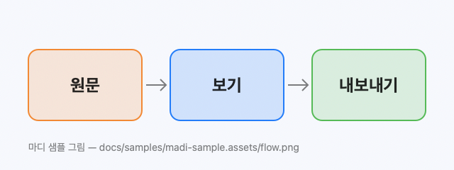

# 마디 기능 시험 문서

이 문서는 **마디가 그리는 것 전부**를 한곳에 모은 시험 문서입니다. 기능을 고친 뒤 열어서 위에서부터
굴려 보면 깨진 곳이 바로 보입니다. 시험(`SampleDocumentTests`)도 이 문서를 열어 같은 것을 확인합니다.

각 절의 제목 옆에 무엇을 보면 되는지 적었습니다. 캐럿을 그 줄에 두면 원문이 보이고, 떠나면 다시 그려집니다.

## 1. 글자 꾸밈 — 표시가 숨고 모양만 남아야 합니다

**굵게**, *기울임*, ***굵고 기울임***, ~~취소선~~, `인라인 코드`, 그리고 [링크](https://example.com).

한국어 조사가 바로 붙어도 됩니다: *기울임*은, **굵게**를, `코드`로, **"따옴표 안 굵게"**는, **괄호(안쪽)**을.

겹친 꾸밈: *바깥 기울임 **안쪽 굵게** 다시 기울임*, **바깥 굵게 *안쪽 기울임* 다시 굵게**, [*기울인 링크*](https://example.com),
**[굵은 링크](https://example.com)**, ~~**굵은 취소선**~~.

Notion에서 내보낸 꼴: **프로필 네임스페이스 (****`user-namespace`**) — 별표 넷이 보이면 안 됩니다.
***왜 이렇게 하나****: 굵고 기울인 머리 뒤에 기울인 설명이 이어집니다.*

글자로 남아야 하는 것: \*별표 그대로\*, snake_case_name, 5 * 3 * 2, 짝 없는 **별표 하나*.

## 2. 제목 — 크기가 단계별로 줄고, 목차에 모두 나와야 합니다

### 제목 3

#### 제목 4

##### 제목 5

###### 제목 6

밑줄 제목 1
===========

밑줄 제목 2
-----------

## 3. 링크와 각주 — ⌘클릭으로 열고, 각주는 오갑니다

- 인라인 링크: [예시 사이트](https://example.com/inline "제목 있는 링크")
- 꺾쇠 자동 링크: <https://example.com/autolink>
- 참조 링크: [참조로 적은 링크][참조] · 줄인 꼴 [참조][]
- 각주: 마디는 문서를 바이트 그대로 지킵니다[^보존]. 각주는 여러 개일 수 있습니다[^둘].
- 그냥 적은 주소(링크가 아님): https://example.com/plain

[참조]: https://example.com/reference "참조 링크의 주소"

## 4. 목록 — 글머리 · 번호 · 할 일, 들여쓰기

- 첫째 항목
- 둘째 항목에는 **굵은 글**과 `코드`가 있습니다
  - 한 단계 들어간 항목
    - 두 단계 들어간 항목
- 셋째 항목

1. 번호 목록 하나
2. 번호 목록 둘
   1. 안쪽 번호
   2. 안쪽 번호 둘
3. 번호 목록 셋

- [x] 끝난 할 일 — 상자에 체크가 그려져야 합니다
- [ ] 남은 할 일 — 상자를 누르면 체크됩니다
- [ ] 할 일 안의 *기울임*과 [링크](https://example.com)

## 5. 인용과 알림 상자 — 막대와 색 머리

> 인용은 왼쪽 막대로 그립니다. 여러 줄이어도
> 막대 하나로 이어집니다.
>
> > 겹친 인용은 막대가 하나 더 들어갑니다.

> [!NOTE]
> 알아 두면 좋은 것. 파란 머리에 `Note`가 보여야 합니다.

> [!TIP]
> 더 잘 쓰는 법.

> [!IMPORTANT]
> 꼭 알아야 하는 것.

> [!WARNING]
> 조심할 것.

> [!CAUTION]
> 위험한 것.

## 6. 코드 블록 — 강조 색, 복사 단추, 긴 줄은 가로로

마우스를 블록에 올리면 오른쪽 위에 `복사` 단추가 뜹니다.

```swift
/// 마크다운을 읽어 편집기에 싣는다.
struct Note: Codable {
    let title: String
    var views = 42
}
let editor = MarkdownEditorView()
editor.markdown = "# 제목"   // 고치면 바로 그려진다
```

```python
def greet(name: str) -> str:
    """독스트링도 문자열 색입니다."""
    return f"안녕하세요, {name}"  # 주석은 흐립니다
```

```bash
# 짧은 셸 명령은 줄이 바뀌지 않습니다
ls -la ~/Documents | grep md
```

아래 블록은 줄이 글 칸보다 깁니다 — 줄을 바꾸지 않고 상자 오른쪽에서 잘리며, 옆으로 굴리면 이어집니다.
블록을 누르면 원문(줄을 바꾼 글)이 됩니다.

```bash
kubectl get node -owide
NAME       STATUS   ROLES           AGE     VERSION        INTERNAL-IP   EXTERNAL-IP   OS-IMAGE           KERNEL-VERSION       CONTAINER-RUNTIME
node-1     Ready    control-plane   4m40s   v1.36.5+k3s1   192.0.2.10    <none>        Ubuntu 26.04 LTS   7.0.0-38-generic     containerd://2.3.4
node-2     Ready    worker          4m12s   v1.36.5+k3s1   192.0.2.11    <none>        Ubuntu 26.04 LTS   7.0.0-38-generic     containerd://2.3.4
```

붙은 두 블록(닫자마자 다음 블록) — 복사 단추는 마우스 아래 블록만 베낍니다.

```json
{ "name": "madi", "version": 1, "tags": ["editor", "markdown"], "draft": false }
```
```yaml
name: madi
on:
  push:
    branches: [master]
```

언어 이름이 없는 블록:

```
그냥 고정폭 글. 강조 색은 없습니다.
**별표**도 글자 그대로입니다.
```

- 목록 안의 블록 — 복사하면 앞의 들여쓰기가 빠집니다.
  ```bash
  echo "목록 안"
  ```

## 7. 표 — 격자, 정렬, 넓은 표는 가로로

| 기능 | 단축키 | 상태 |
|:---|:---:|---:|
| 원본 보기 | ⌘E | 있음 |
| 번역 | ⌘⇧T | 있음 |
| 나란히 보기 | ⌃⌘T | 있음 |

칸 안의 꾸밈과 막대 글자:

| 구성요소 | 설명 |
| --- | --- |
| **PodDefault** `access-config` | 노트북에 [설정](https://example.com)을 *자동으로* 넣습니다 |
| 막대 글자 | `a \| b`처럼 칸 안에서 막대를 씁니다 |
| 긴 설명 | 칸 안에서 줄이 바뀌어야 합니다. 이름 열은 한 줄로 남고 설명 열만 꺾입니다. 표가 글 칸보다 넓어지지 않는 한 가로 막대는 생기지 않습니다. |

열이 많은 표 — 열이 너무 좁아지지 않고, 넘치면 가로로 굴립니다:

| 구분 | 원작 구성 | 이번 실습 구성 | 배포 방식 | 이름공간 | 진행 상태 | 담당 팀 | 버전 정보 | 열린 포트 | 저장 위치 | 남은 일 | 비고 |
| --- | --- | --- | --- | --- | --- | --- | --- | --- | --- | --- | --- |
| **기본 플랫폼** | 전체 구성요소 설치 | 필요한 구성요소만 골라 설치 | Kustomize | `example-namespace` | 완료했습니다 | 플랫폼 팀 | v26.03.1 | 30000-30003 | 내장 저장소 | 없습니다 | 메모리 제한 제거 |
| **저장소** | MinIO 따로 설치 | 내장 저장소 사용 | Kustomize | `storage-namespace` | 진행하는 중 | 데이터 팀 | 4.34 | 8888 | 버킷 두 개 | 권한 정리 | 버킷 자동 생성 |

## 8. 그림 — 자기 줄이면 그림, 글 사이면 원문



줄 끝에 `\`가 붙은 그림 줄도 그림으로 보입니다:

\

글 사이에 끼인 그림 은 원문으로 남습니다.

없는 파일을 가리키는 그림은 링크 글로 남습니다: 

## 9. 다이어그램과 수식 — 그림으로 그려집니다


$$
\int_0^1 x^2 \, dx = \frac{1}{3}
$$

```math
e^{i\pi} + 1 = 0
```

## 10. 구분선 · HTML · 그 밖

아래 셋은 모두 구분선입니다.

---

***

___

<details>
<summary>HTML은 원문 그대로 보입니다</summary>

안쪽 글.

</details>

이모지와 여러 글자: 👍🏻 🙇🏻 ✅ — 한글 · English · 日本語 · 中文 · العربية.

줄 끝에 공백 둘을 두면  
줄이 바뀝니다. 역슬래시도\
줄을 바꿉니다.

길게 이어지는 문단: 마디는 보는 화면에서 바로 고치는 마크다운 편집기입니다. 캐럿이 있는 줄만 원문이 보이고 나머지 줄은 문서처럼 그려지므로, 원문 보기와 미리 보기를 오가지 않아도 됩니다. 이 문단은 창 폭에 맞춰 여러 줄로 바뀌어야 하고, 창을 좁히거나 넓혀도 글자가 겹치지 않아야 합니다.

[^보존]: 저장할 때 front matter와 줄바꿈까지 그대로 다시 씁니다.
[^둘]: 각주 라벨을 ⌘클릭하면 본문의 참조로 돌아갑니다.
